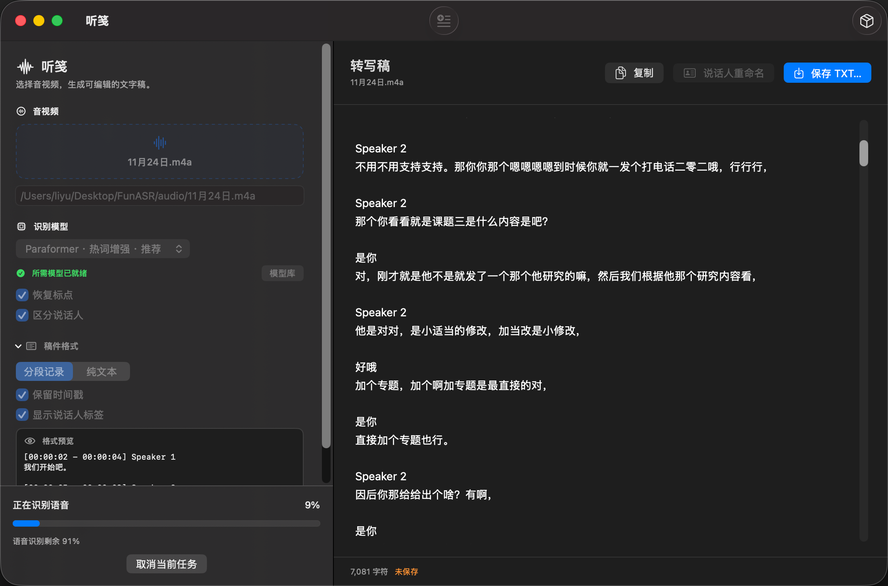
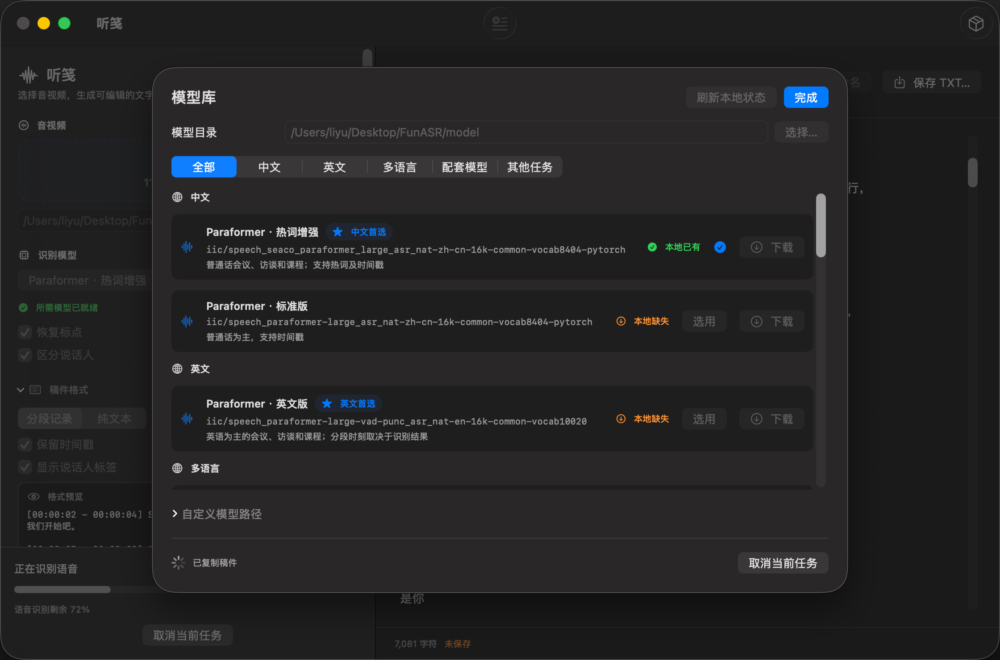
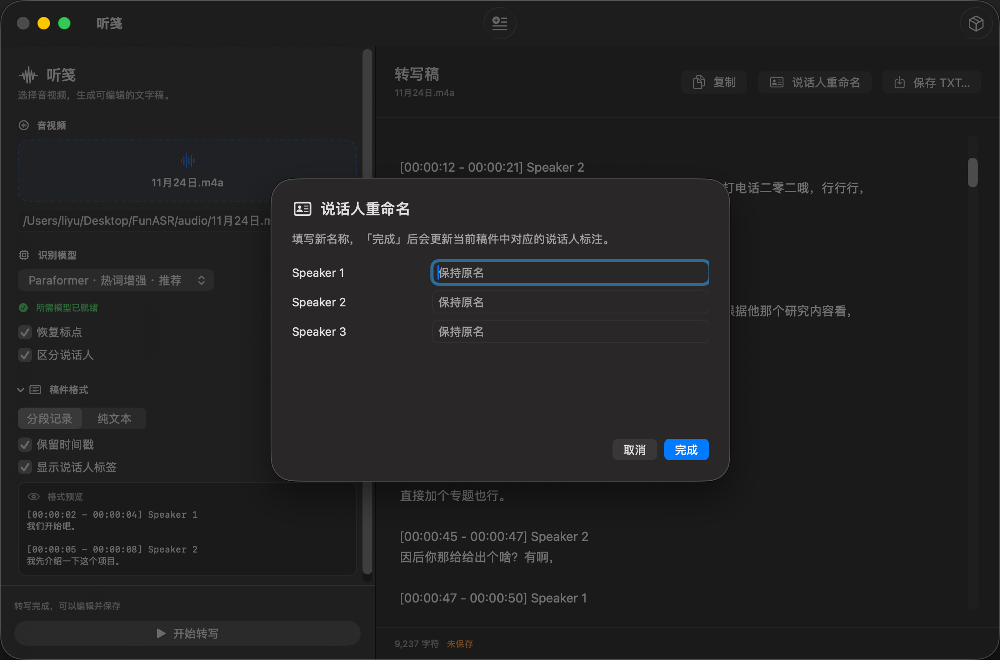

# 听笺 · 免费本地语音转文字

**把会议录音、访谈、课程和视频变成可以直接校对的文字稿。**

**简体中文** · [English](docs/README.en.md) · [Deutsch](docs/README.de.md) · [Français](docs/README.fr.md)

`macOS 26+` · `Apple Silicon` · `本地转写` · `免费非商业使用`

把文件拖进听笺，在右侧查看和修改转写结果，再复制或保存为 TXT。模型准备好后，转写可以离线完成，音视频留在你的 Mac 上。

## 从录音到文字稿

**导入音视频，查看进度。** 拖入文件、使用文件选择器，或粘贴文件路径。转写时能看到当前阶段、语音识别进度和剩余比例，也可取消当前任务。

**按录音语言选模型。** 模型库按中文、英文和多语言等用途分类，显示推荐、模型 ID 和本地状态。可以下载所需模型，也可以选择已有的模型目录。普通话会议可选 Paraformer 热词增强版，英语录音可选 Paraformer 英文版，粤语、日语、韩语等录音可考虑 SenseVoiceSmall。

**给说话人换成好认的名字。** 在分段记录中开启说话人标签，生成稿件后可以把 `Speaker 1` 改成「主持人」，把 `Speaker 2` 改成「受访者」。填了名字的标签会在整份稿件中一起更新，留空的保留原名。时间戳可按需保留。

## 让稿件更容易使用

| 功能 | 可以做什么 |
| --- | --- |
| **实时格式预览** | 转写前预览分段记录与纯文本的区别，按需显示说话人标签和时间戳。 |
| **标点和热词** | 按当前模型的支持情况恢复标点。用热词增强模型转写时，可粘贴或导入人名、项目名及专业术语词表。 |
| **编辑、复制、保存** | 直接在右侧校对全文，复制到笔记或文档，或保存为 UTF-8 TXT。 |
| **未保存提醒** | 当前稿件从未保存时，换文件或重新转写前会先询问。 |

## 安装和使用

1. 在 **Apple Silicon Mac（macOS 26 或以上）** 上双击听笺的 `.pkg` 安装包。安装完成后，从 Finder 的「应用程序」打开听笺。
2. 首次使用时，从模型库下载所需模型，或选择已有模型目录。
3. 选入录音，点击「开始转写」。写完后在右侧校对，再点「保存 TXT」。

桌面界面目前为简体中文。安装包自带运行环境，当前构建尚未经过 Apple 公证，其他 Mac 可能显示系统验证提示。

## 源码与许可

听笺基于 [FunASR](https://github.com/modelscope/FunASR)。听笺自身源码公开，按 [PolyForm Noncommercial License 1.0.0](LICENSE) 授权，免费用于许可证允许的用途，商业使用须另获授权。FunASR、识别模型和其他第三方组件各自适用其许可证。

开发者可查看[构建说明](docs/BUILD.md)。
