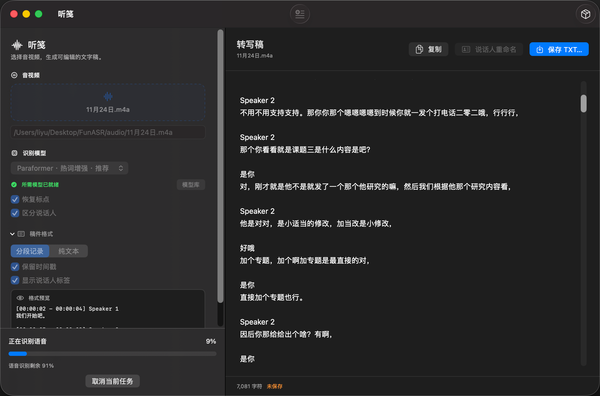
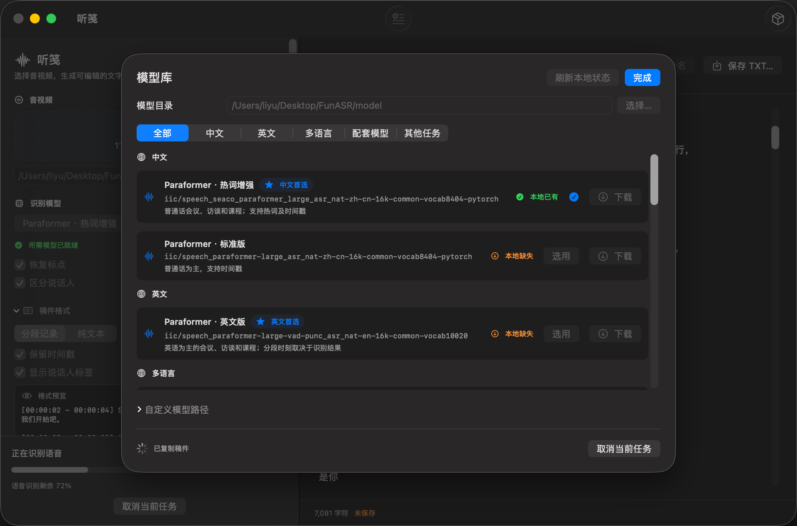
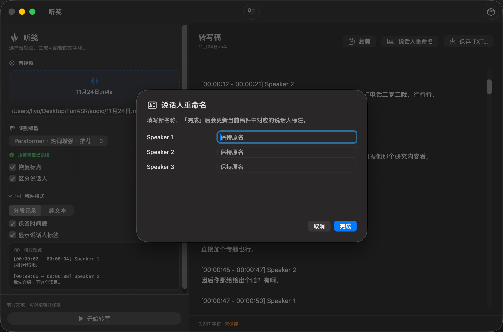

# 听笺 (Tingjian) · Kostenlose lokale Transkription für den Mac

**Besprechungen, Interviews, Vorlesungen und Videos als bearbeitbaren Text festhalten.**

[简体中文](../README.md) · [English](README.en.md) · **Deutsch** · [Français](README.fr.md)

`macOS 26+` · `Apple Silicon` · `Offline-Transkription` · `Kostenlos für nichtkommerzielle Nutzung`

Ziehen Sie eine Audio- oder Videodatei in Tingjian, bearbeiten Sie das Transkript und kopieren oder speichern Sie es als TXT. Sobald die Modelle bereitstehen, funktioniert die Transkription offline. Die Aufnahmen bleiben auf Ihrem Mac.

## Von der Aufnahme zum Transkript

**Datei importieren und Fortschritt verfolgen.** Ziehen Sie die Datei ins Fenster, wählen Sie sie aus oder fügen Sie ihren Pfad ein. Die App zeigt den aktuellen Schritt und den Fortschritt der Spracherkennung an. Sie können den Vorgang abbrechen.

**Ein passendes Sprachmodell wählen.** Die Bibliothek bietet Empfehlungen für Chinesisch, Englisch und mehrsprachige Aufnahmen und zeigt Modell-ID und lokale Verfügbarkeit. Laden Sie benötigte Modelle herunter oder verwenden Sie bereits vorhandene Modelle.

**Sprechende umbenennen.** Aktivieren Sie Sprecherkennzeichnungen im segmentierten Format. Nach der Transkription können Sie `Speaker 1` beispielsweise durch „Moderation“ ersetzen. Die Änderung gilt für alle entsprechenden Kennzeichnungen im Transkript. Leere Felder behalten die ursprünglichen Namen bei. Zeitmarken sind optional.

## Das Transkript weiterverwenden

- **Format vorab prüfen.** Wählen Sie segmentierte Aufzeichnungen oder reinen Text und legen Sie fest, ob Zeitmarken und Sprecherkennzeichnungen erscheinen.
- **Satzzeichen und Fachbegriffe nutzen.** Je nach Modell können Satzzeichen ergänzt werden. Beim Paraformer-Modell mit Schlüsselwortunterstützung lassen sich Namen und Fachbegriffe als UTF-8-TXT importieren oder einfügen.
- **Bearbeiten, kopieren und speichern.** Exportieren Sie den korrigierten Text als UTF-8-TXT. Vor dem Ersetzen eines noch nie gespeicherten Transkripts fragt Tingjian nach.

## Installation und Einstieg

1. Öffnen Sie das `.pkg`-Installationspaket auf einem **Apple-Silicon-Mac mit macOS 26 oder neuer**. Anschließend finden Sie Tingjian unter „Programme“.
2. Laden Sie die benötigten Modelle in der Modellbibliothek herunter oder wählen Sie ein vorhandenes Modellverzeichnis.
3. Importieren Sie eine Aufnahme, starten Sie die Transkription und speichern Sie den überprüften Text.

Die Benutzeroberfläche ist derzeit auf vereinfachtem Chinesisch verfügbar. Das Paket enthält die Laufzeitumgebung. Die aktuelle Version ist noch nicht von Apple notarisiert, daher kann macOS einen Prüfhinweis anzeigen.

## Quellcode und Lizenz

Tingjian basiert auf [FunASR](https://github.com/modelscope/FunASR). Der Tingjian-Quellcode ist unter der [PolyForm Noncommercial License 1.0.0](../LICENSE) öffentlich zugänglich. Für die kommerzielle Nutzung ist eine gesonderte Genehmigung erforderlich. Für FunASR, Modelle und weitere Komponenten gelten deren eigene Lizenzen.

Siehe [Build-Anleitung auf Chinesisch](BUILD.md).
