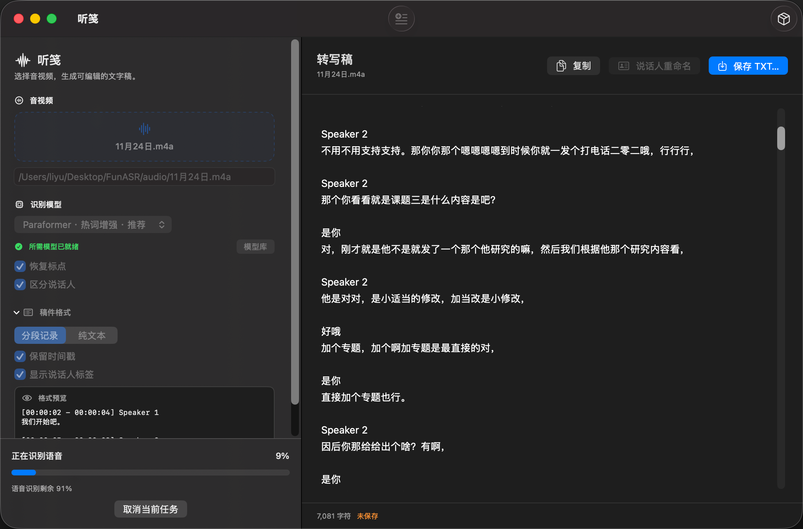
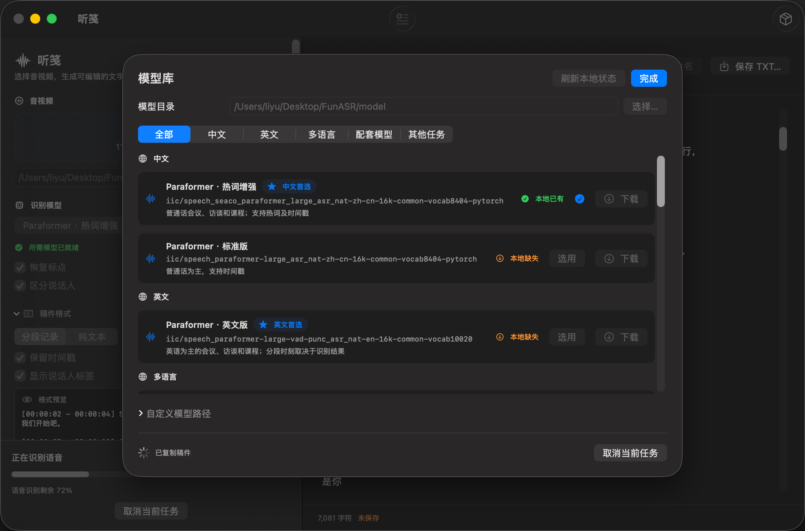
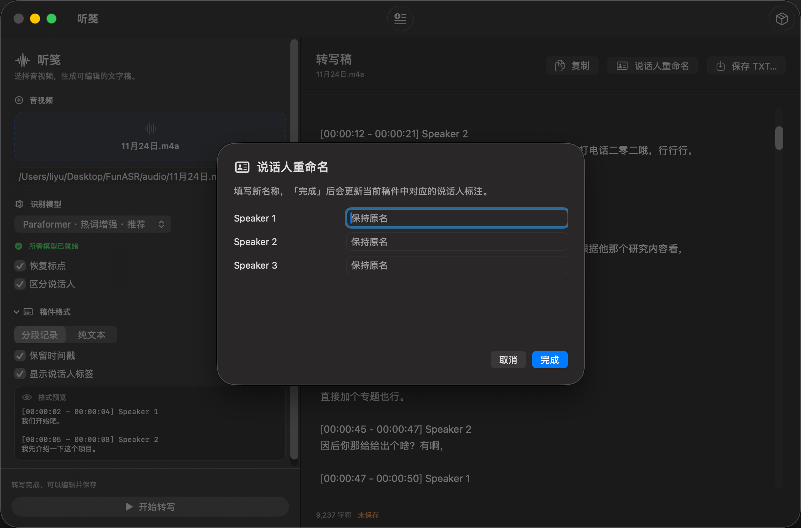

# 听笺 (Tingjian) · Free local speech-to-text for Mac

**Turn meeting recordings, interviews, lectures, and videos into transcripts you can edit.**

[简体中文](../README.md) · **English** · [Deutsch](README.de.md) · [Français](README.fr.md)

`macOS 26+` · `Apple Silicon` · `Offline transcription` · `Free for noncommercial use`

Drop an audio or video file into Tingjian, review the result in the editor, then copy it or save it as TXT. Once the models are ready, transcription works offline and your recordings stay on your Mac.

## From recording to transcript

**Import a file and follow its progress.** Drop a file, pick one in Finder, or paste its path. See the current stage and speech recognition progress, and cancel the job if needed.

**Choose a model for the recording.** Browse Chinese, English, and multilingual options with recommendations, model IDs, and local availability. Download the models you need or point Tingjian to models you already have.

**Rename speakers.** Enable speaker labels in the segmented format. Once the transcript is ready, replace `Speaker 1` with “Host” or `Speaker 2` with “Guest” throughout the speaker labels. Leave a field blank to keep the original label. Timestamps are optional.

## Make the transcript yours

- **Preview the layout** before transcribing. Choose segmented notes or plain text, with optional timestamps and speaker labels.
- **Add punctuation and key terms** where the model supports them. The hotword-enhanced Paraformer model accepts a pasted or imported UTF-8 TXT word list for names and specialist terms.
- **Edit, copy, and save** the finished text as UTF-8 TXT. Tingjian prompts before replacing a transcript that has never been saved.

## Install and get started

1. Open the `.pkg` installer on an **Apple Silicon Mac running macOS 26 or later**, then launch Tingjian from Applications.
2. Download the required models in the model library or select an existing local model directory.
3. Import a recording, start transcription, then review and save the result.

The desktop interface is currently in Simplified Chinese. The installer includes the runtime. The current build has not been notarized by Apple and may trigger a macOS verification prompt.

## Source and license

Tingjian is based on [FunASR](https://github.com/modelscope/FunASR). The Tingjian source is publicly available under the [PolyForm Noncommercial License 1.0.0](../LICENSE). Commercial use requires separate permission. FunASR, models, and other third-party components retain their own licenses.

See the [build instructions in Chinese](BUILD.md).
