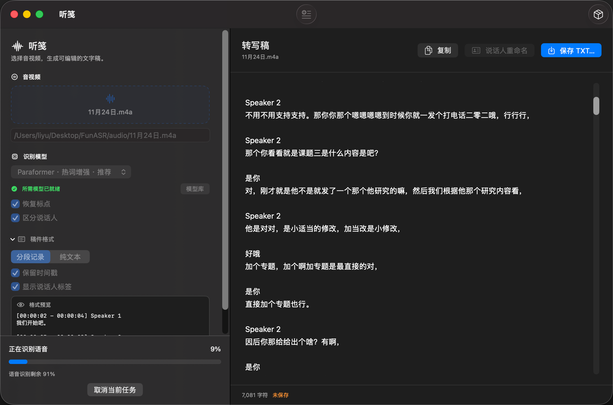
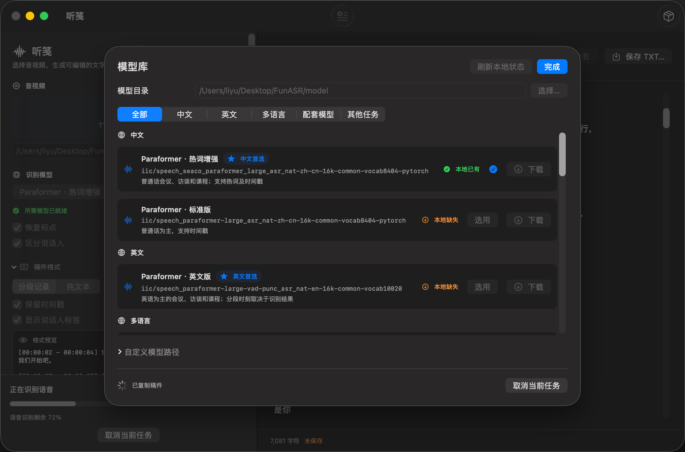
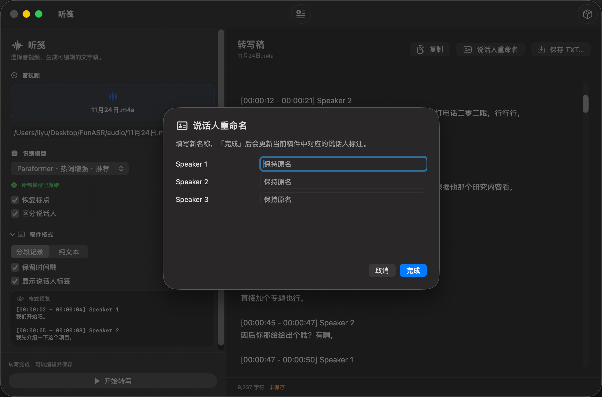

# 听笺 (Tingjian) · Transcription locale gratuite sur Mac

**Transformez vos réunions, entretiens, cours et vidéos en texte modifiable.**

[简体中文](../README.md) · [English](README.en.md) · [Deutsch](README.de.md) · **Français**

`macOS 26+` · `Apple Silicon` · `Transcription hors ligne` · `Gratuit pour un usage non commercial`

Déposez un fichier audio ou vidéo dans Tingjian, relisez la transcription, puis copiez-la ou enregistrez-la au format TXT. Une fois les modèles prêts, la transcription fonctionne hors ligne et les enregistrements restent sur votre Mac.

## De l’enregistrement au texte

**Importez un fichier et suivez la progression.** Glissez le fichier dans la fenêtre, sélectionnez-le ou collez son chemin. L’application indique l’étape en cours et la progression de la reconnaissance vocale. Vous pouvez annuler la tâche.

**Choisissez un modèle adapté.** La bibliothèque présente les modèles recommandés pour le chinois, l’anglais et les enregistrements multilingues, ainsi que leur identifiant et leur disponibilité locale. Téléchargez les modèles nécessaires ou réutilisez ceux déjà présents sur votre Mac.

**Renommez les intervenants.** Activez les étiquettes de locuteur dans le format segmenté. Après la transcription, remplacez par exemple `Speaker 1` par « Présentatrice » dans toutes les étiquettes correspondantes. Laissez un champ vide pour conserver le nom d’origine. Les horodatages sont facultatifs.

## Préparez un texte prêt à partager

- **Prévisualisez la mise en forme.** Choisissez des notes segmentées ou du texte brut, avec des horodatages et des étiquettes de locuteur selon vos besoins.
- **Soignez la ponctuation et le vocabulaire.** Selon le modèle choisi, Tingjian peut ajouter la ponctuation. Avec le modèle Paraformer prévu pour les mots-clés, collez ou importez une liste UTF-8 TXT de noms ou de termes spécialisés.
- **Corrigez, copiez et enregistrez.** Exportez le texte relu en UTF-8 TXT. Tingjian demande confirmation avant de remplacer une transcription qui n’a jamais été enregistrée.

## Installation et premiers pas

1. Ouvrez le paquet `.pkg` sur un **Mac Apple Silicon équipé de macOS 26 ou d’une version ultérieure**, puis lancez Tingjian depuis le dossier Applications.
2. Téléchargez les modèles nécessaires depuis la bibliothèque ou sélectionnez un dossier de modèles existant.
3. Importez un enregistrement, lancez la transcription, puis relisez et enregistrez le texte.

L’interface est actuellement en chinois simplifié. Le paquet inclut l’environnement d’exécution. La version actuelle n’a pas été notariée par Apple et macOS peut afficher un avertissement de vérification.

## Code source et licence

Tingjian s’appuie sur [FunASR](https://github.com/modelscope/FunASR). Le code source de Tingjian est public sous la [licence PolyForm Noncommercial 1.0.0](../LICENSE). Toute utilisation commerciale nécessite une autorisation distincte. FunASR, les modèles et les autres composants tiers conservent leurs propres licences.

Consultez les [instructions de compilation en chinois](BUILD.md).
